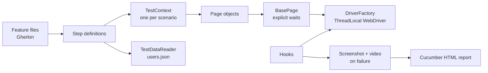

# Selenium Java BDD Automation Framework

[](https://github.com/paresagarqa-git/selenium-java-bdd-automation/actions/workflows/selenium-tests.yml)


A UI test automation framework for web applications, built with **Selenium WebDriver, Java, Cucumber (BDD) and TestNG** on the **Page Object Model**.
It runs **cross-browser** (Chrome, Firefox, Edge), executes scenarios **in parallel**, reads test data from **external JSON files**, and produces
**HTML reports with a screenshot and video of every failure**. Every pull request is tested in **GitHub Actions** on all three browsers.

The application under test is [the-internet.herokuapp.com](https://the-internet.herokuapp.com), a public practice site with
login, form controls, dynamic content and JavaScript alerts.

---

## Highlights

| Capability | How it is done |
|---|---|
| **BDD** | Business-readable Gherkin feature files, tagged `@smoke`, `@regression`, `@negative` |
| **Page Object Model** | One class per page; locators and actions are kept out of the step definitions |
| **Data-driven testing** | Login accounts in `testdata/users.json`, used through Scenario Outlines |
| **Cross-browser** | Chrome, Firefox and Edge, selected with `-Dbrowser=` |
| **Parallel execution** | Scenarios run on a TestNG thread pool, one isolated browser per thread |
| **Failure evidence** | Screenshot + MP4 video embedded in the Cucumber HTML report and saved as files |
| **Explicit waits only** | No `Thread.sleep` and no implicit waits, so tests are fast and stable |
| **Configurable** | `config.properties`, every value overridable from the command line |
| **CI/CD** | GitHub Actions browser matrix on every push and pull request, reports uploaded as artifacts |

---

## Tech stack

| Tool | Version | Role |
|---|---|---|
| Java | 17 | Language |
| Maven | 3.8+ | Build and dependency management |
| Selenium WebDriver | 4.54 | Browser automation |
| Cucumber | 7.34 | BDD: Gherkin features and step definitions |
| TestNG | 7.12 | Test runner and parallel execution |
| Cucumber PicoContainer | 7.34 | Dependency injection between step classes |
| WebDriverManager | 6.4 | Resolves the matching browser driver automatically |
| Jackson | 2.23 | Reads JSON test data |
| JCodec | 0.2.5 | Encodes failure videos (MP4) |
| GitHub Actions | | Continuous integration |

---

## Framework design



- **Feature files** describe behaviour in plain English. They never contain locators or code.
- **Step definitions** translate each step into page-object calls and assertions.
- **TestContext** is created fresh for every scenario by PicoContainer and shared by all step classes, so
  page objects and state never leak between scenarios, which is what makes parallel runs safe.
- **Page objects** hold locators and page actions. `BasePage` wraps every interaction in an explicit wait.
- **DriverFactory** creates one WebDriver per thread (`ThreadLocal`), for Chrome, Firefox or Edge, headless or headed.
- **Hooks** open the browser before each scenario, record a frame after each step, and on failure attach a
  screenshot and video to the report before closing the browser.

### Project structure

```
selenium-java-bdd-automation
├── .github/workflows/selenium-tests.yml   CI pipeline (browser matrix)
├── pom.xml                                Dependencies, Surefire + parallel config
├── testng.xml                             TestNG suite
└── src/test
    ├── java/com/sagar/automation
    │   ├── config/          ConfigReader        reads config.properties, -D overrides
    │   ├── context/         TestContext         per-scenario state and page objects
    │   ├── data/            TestDataReader, User   loads JSON test data
    │   ├── driver/          DriverFactory       ThreadLocal WebDriver, cross-browser
    │   ├── hooks/           Hooks               setup, teardown, failure evidence
    │   ├── pages/           BasePage + 6 page objects
    │   ├── runners/         TestRunner          Cucumber + TestNG, parallel DataProvider
    │   ├── stepdefinitions/ LoginSteps, UiInteractionSteps, ParameterTypes
    │   └── utils/           ScreenshotUtil, VideoRecorder
    └── resources
        ├── config/config.properties           base URL, browser, timeouts, video mode
        ├── features/                          Gherkin feature files
        └── testdata/users.json                login test data
```

---

## Test coverage

**16 scenarios** across 5 features:

| Feature | Scenarios | What it proves |
|---|---|---|
| **Login** | 10 | Valid login, logout, and 8 rejected logins: unknown user, wrong password, blank username, blank password, both blank, case-sensitive username, case-sensitive password, SQL-injection input |
| **Checkboxes** | 1 | Reading and changing checkbox state |
| **Dropdown** | 2 | Selecting options with Selenium's `Select` |
| **Dynamic loading** | 1 | Waiting for content that appears after a delay |
| **JavaScript alerts** | 2 | Accepting an alert and typing into a prompt |

A separate `@demo` scenario fails on purpose to show the failure screenshot and video. It is excluded from normal runs.

---

## Data-driven testing

Test data is kept apart from code and feature files in `src/test/resources/testdata/users.json`:

```json
"invalid_password":   { "username": "tomsmith", "password": "wrongpassword",        "description": "Wrong password" },
"uppercase_username": { "username": "TOMSMITH", "password": "SuperSecretPassword!", "description": "Username is case-sensitive" }
```

Feature files refer to users by key, and a Scenario Outline runs once per row:

```gherkin
@regression @negative
Scenario Outline: Login is rejected for the "<user>" user
  When I log in as the "<user>" user
  Then I should see the flash message "<message>"
  And I should be on the login page

  Examples:
    | user               | message                   |
    | invalid_password   | Your password is invalid! |
    | uppercase_username | Your username is invalid! |
```

Adding a test case means adding a row to the JSON file and the Examples table. No Java changes are needed.

---

## Getting started

**Prerequisites:** JDK 17+, Maven 3.8+, and Chrome (Firefox and Edge optional).

```bash
git clone https://github.com/paresagarqa-git/selenium-java-bdd-automation.git
cd selenium-java-bdd-automation
mvn test
```

### Common commands

| Goal | Command |
|---|---|
| Run everything (visible browser) | `mvn test` |
| Headless, as in CI | `mvn test -Dheadless=true` |
| Smoke tests only | `mvn test -Dcucumber.filter.tags="@smoke"` |
| Negative login cases only | `mvn test -Dcucumber.filter.tags="@negative"` |
| Firefox / Edge | `mvn test -Dbrowser=firefox` / `mvn test -Dbrowser=edge` |
| More parallel threads | `mvn test -Dthreads=8` |
| One scenario at a time (debugging) | `mvn test -Dthreads=1` |
| Video for every scenario | `mvn test -Dvideo.mode=always` |
| See a failure report with screenshot + video | `mvn test -Dcucumber.filter.tags="@demo"` |
| Check all steps are implemented, no browser | `mvn test -Dcucumber.execution.dry-run=true` |

### Configuration

`src/test/resources/config/config.properties`. Any key can be overridden with `-Dkey=value`.

| Key | Default | Meaning |
|---|---|---|
| `base.url` | `https://the-internet.herokuapp.com` | Application under test |
| `browser` | `chrome` | `chrome`, `firefox` or `edge` |
| `headless` | `false` | Run without a visible window |
| `explicit.wait.seconds` | `10` | Max wait for an element |
| `page.load.timeout.seconds` | `30` | Max wait for a page load |
| `video.mode` | `on-failure` | `on-failure`, `always` or `off` |

Parallel thread count is the Maven property `threads` (default `4`).

---

## Reports and failure evidence

| Output | Location |
|---|---|
| Cucumber HTML report (with embedded screenshot and video for failures) | `target/cucumber-reports/cucumber.html` |
| Cucumber JSON (for other report tools) | `target/cucumber-reports/cucumber.json` |
| Failed scenarios list (for re-runs) | `target/cucumber-reports/rerun.txt` |
| Failure screenshots (PNG) | `target/screenshots/` |
| Failure videos (MP4) | `target/videos/` |
| TestNG results | `target/surefire-reports/` |

**About the video:** Selenium has no built-in screen recorder. The framework takes a screenshot after every
step and encodes them into an MP4 (one second per step) with JCodec. This works the same in every browser,
headless or not, and in parallel runs. Screenshots are skipped while a JavaScript alert is open, because
capturing one would dismiss the alert.

---

## Parallel and cross-browser execution

- `TestRunner` overrides Cucumber's `scenarios()` DataProvider with `parallel = true`, and Surefire passes
  the thread count to TestNG (`dataproviderthreadcount`).
- Each thread gets its own browser through `ThreadLocal<WebDriver>`, and its own `TestContext` through PicoContainer.
- Driver binaries are resolved once under a lock, so threads don't race to download them.
- The console prints `[thread] browser | scenario` for each scenario, so parallel execution is visible in the logs.

---

## Continuous integration

[`.github/workflows/selenium-tests.yml`](.github/workflows/selenium-tests.yml) runs:

- on every push to `main` and every pull request
- on demand from **Actions → Selenium BDD Tests → Run workflow**, with optional tag expression and thread count

Chrome, Firefox and Edge run as **three parallel jobs** (headless), and scenarios run in parallel inside each job.
Every run uploads `cucumber-report-<browser>` and `surefire-reports-<browser>`; failed runs also upload
`failure-screenshots-<browser>` and `failure-videos-<browser>`.

---

## Author

**Sagar Pare** · QA Automation · [GitHub](https://github.com/paresagarqa-git)
